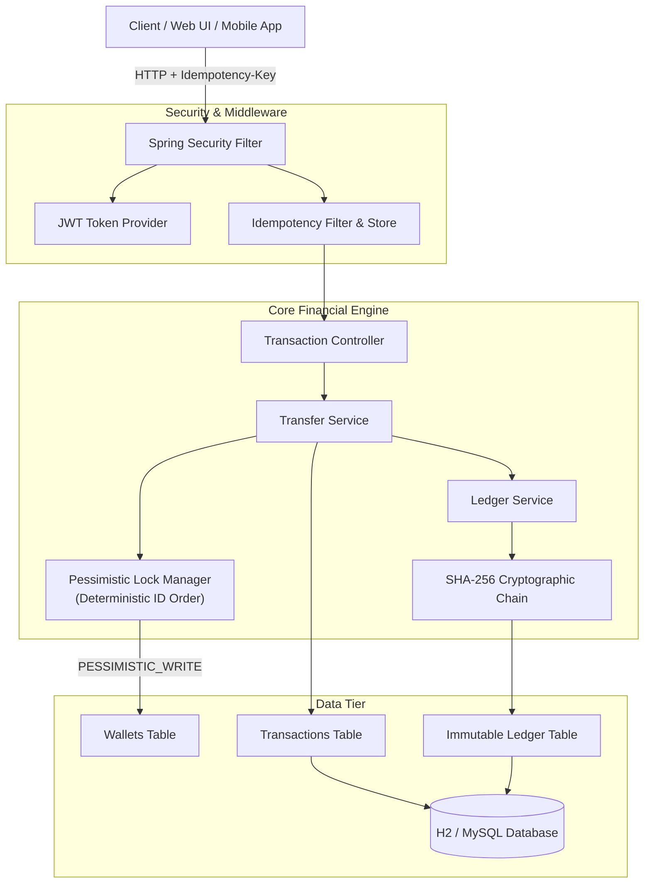

# LedgeFlow 💳⚡
> **Enterprise Digital Wallet & Cryptographic Double-Entry Ledger Engine**

[](https://spring.io/projects/spring-boot)
[](https://www.oracle.com/java/)
[](https://spring.io/projects/spring-security)
[](LICENSE)

**LedgeFlow** is a production-grade backend financial service designed to showcase advanced backend software engineering principles for placement interviews, including:
1. **Double-Entry Bookkeeping Ledger**: Strict dual-posting (Every Debit has an equal Credit; $\sum \text{Debits} = \sum \text{Credits}$).
2. **ACID Concurrency Control & Row-Level Locking**: Pessimistic write locks (`SELECT ... FOR UPDATE`) with deterministic resource ordering to completely eliminate race conditions, double-spending, and deadlocks.
3. **API Idempotency Engine**: In-flight request locking and response caching to prevent duplicate debits from network retries.
4. **Cryptographic SHA-256 Tamper-Evident Audit Chain**: Merkle/Blockchain-style hash chaining where every ledger entry signs the hash of the preceding entry. Direct database tampering is mathematically detected in milliseconds.
5. **Role-Based Access Control (RBAC) & JWT**: Stateless token security with fine-grained endpoint authorization.
6. **Live Interactive Dashboard**: Embedded glassmorphism web interface with real-time balance updates, visual dual postings, and one-click tamper auditing.

---

## 🏛️ System Architecture



---

## 💡 Placement Interview Highlights & Talking Points

When presenting LedgeFlow during technical interviews, emphasize these 5 architectural pillars:

### 1. Why Double-Entry Accounting?
* **Problem**: In naive wallet apps, a transfer simply updates `sender.balance -= 100` and `receiver.balance += 100`. If one query fails or a floating-point error happens, money mysteriously appears or disappears.
* **LedgeFlow Solution**: Uses the enterprise accounting equation:
  $$\text{Assets} = \text{Liabilities} + \text{Equity}$$
  Every money movement records a pair of atomic immutable entries:
  - Leg 1: `DEBIT` on sender account
  - Leg 2: `CREDIT` on receiver account
  - An audit reconciliation endpoint (`/api/v1/ledger/reconciliation`) mathematically verifies that total debits equal total credits across the entire ledger.

### 2. Deadlock-Free Pessimistic Locking
* **Problem**: If User A transfers to User B while User B simultaneously transfers to User A, standard locking can cause a classic circular deadlock (`Thread 1 holds A waiting for B; Thread 2 holds B waiting for A`).
* **LedgeFlow Solution**: We enforce **Deterministic Resource Ordering**:
  ```java
  Long firstId = source.getId() < target.getId() ? source.getId() : target.getId();
  Long secondId = source.getId() < target.getId() ? target.getId() : source.getId();
  walletRepository.findByIdWithLock(firstId);
  walletRepository.findByIdWithLock(secondId);
  ```
  Both threads always acquire locks in the same numerical order, guaranteeing that circular wait can never occur.

### 3. API Idempotency Under Network Failures
* **Problem**: If an ATM or mobile app initiates a $500 transfer and the network drops before receiving the response, the client retries. A naive server charges the user twice ($1,000).
* **LedgeFlow Solution**: Clients supply an `Idempotency-Key` header.
  - While processing: locks the key in an in-flight state.
  - On retry: returns the exact cached HTTP response with zero duplicate ledger postings.

### 4. Cryptographic Blockchain-Style Audit Trail
* Every ledger entry contains:
  $$H_n = \text{SHA-256}(H_{n-1} \parallel \text{Seq}_n \parallel \text{Wallet} \parallel \text{Type} \parallel \text{Amount} \parallel \text{BalanceAfter})$$
* If a rogue database admin or attacker modifies any row in the `ledger_entries` table, the chain of hashes downstream is invalidated. The `/api/v1/ledger/verify-integrity` API scans and immediately pinpoints the exact tampered entry.

---

## 🚀 Getting Started

### Prerequisites
- **Java 17, 21, or 25 LTS**
- Maven wrapper is included (`./mvnw.cmd` on Windows, `./mvnw` on Linux/macOS)

### 1. Run the Application
Open a terminal in the project directory:

For a stable JWT signing key across restarts, set the `LEDGEFLOW_JWT_SECRET`
environment variable to a securely generated value of at least 32 bytes before
starting the application. If it is not set, a random key is generated each time
the application starts, so existing tokens will no longer be valid after a restart.

```bash
# Windows
.\mvnw.cmd spring-boot:run

# Linux / macOS
./mvnw spring-boot:run
```

### 2. Access the Interfaces
Once started, visit:
- **Interactive Web App**: [http://localhost:8080/](http://localhost:8080/)
- **Swagger / OpenAPI Documentation**: [http://localhost:8080/swagger-ui/index.html](http://localhost:8080/swagger-ui/index.html)
- **H2 Database Console**: [http://localhost:8080/h2-console](http://localhost:8080/h2-console)
  - JDBC URL: `jdbc:h2:mem:ledgeflowdb`
  - User: `sa`
  - Password: `password`

---

## 👥 Pre-seeded Demonstration Credentials

The application initializes with demo users and active wallets ready for testing:

| Username | Password | Role | Wallet Number | Starting Balance |
| :--- | :--- | :--- | :--- | :--- |
| **alice** | `Alice@123` | `ROLE_USER` | `LF-100001` | **$2,250.00 USD** |
| **bob** | `Bob@123` | `ROLE_USER` | `LF-100002` | **$1,250.00 USD** |
| **admin** | `Admin@123` | `ROLE_ADMIN` | N/A | System Administrator |

---

## 📡 REST API Reference

### 🔐 Authentication (`/api/v1/auth`)
- `POST /api/v1/auth/register` — Register a new user & auto-provision primary wallet
- `POST /api/v1/auth/login` — Authenticate and receive JWT token

### 💼 Wallet Management (`/api/v1/wallets`)
- `GET /api/v1/wallets/me` — List all wallets for the authenticated user
- `GET /api/v1/wallets/{walletNumber}` — Get wallet profile, limits & status
- `GET /api/v1/wallets/{walletNumber}/balance` — Real-time available & held balance
- `PATCH /api/v1/wallets/{walletNumber}/kyc` — *(Admin)* Upgrade KYC tier (TIER_1, TIER_2, TIER_3)
- `PATCH /api/v1/wallets/{walletNumber}/status` — *(Admin)* Freeze/Unfreeze wallet

### 💸 Financial Transactions (`/api/v1/transactions`)
- `POST /api/v1/transactions/deposit` — Top up wallet balance (supports `Idempotency-Key`)
- `POST /api/v1/transactions/withdraw` — Withdraw wallet balance (supports `Idempotency-Key`)
- `POST /api/v1/transactions/transfer` — Atomic P2P transfer (supports `Idempotency-Key`)
- `GET /api/v1/transactions/{reference}` — Query transaction by reference code

### 📜 Ledger & Audit (`/api/v1/ledger`)
- `GET /api/v1/ledger/recent` — View recent immutable ledger postings
- `GET /api/v1/ledger/verify-integrity` — Run full SHA-256 cryptographic chain verification
- `GET /api/v1/ledger/reconciliation` — Accounting balance report (Debits vs Credits)

---

## 🧪 Running Automated Tests

Run the test suite verifying concurrent transfers, idempotency, and tamper detection:

```bash
.\mvnw.cmd test
```

Tests include:
- `LedgeFlowApplicationTests`: Verifies Spring ApplicationContext boots cleanly.
- `TransferServiceTest`: Validates atomic balance updates, insufficient funds exceptions, KYC tier limits, and idempotency key caching.
- `LedgerIntegrityTest`: Validates mathematical debit/credit reconciliation, SHA-256 chain validity, and tests simulated database tampering detection.
